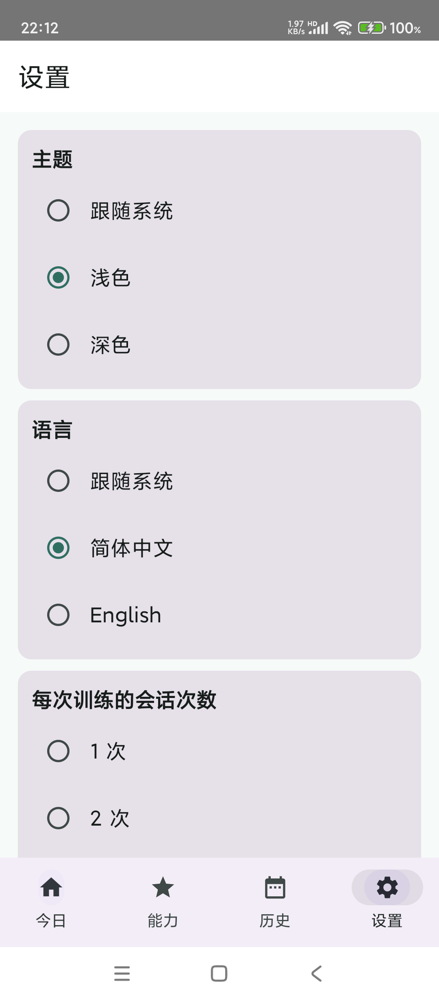
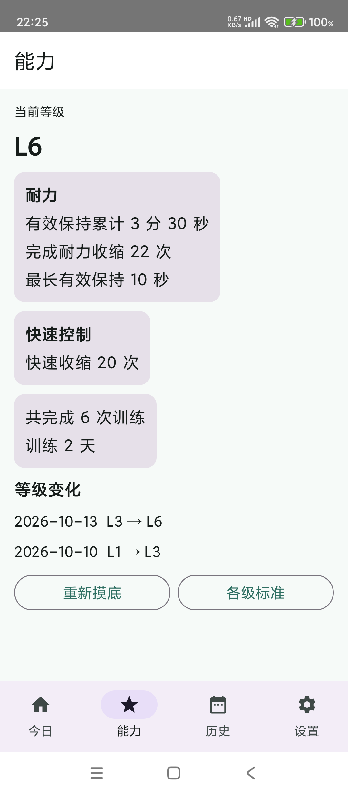
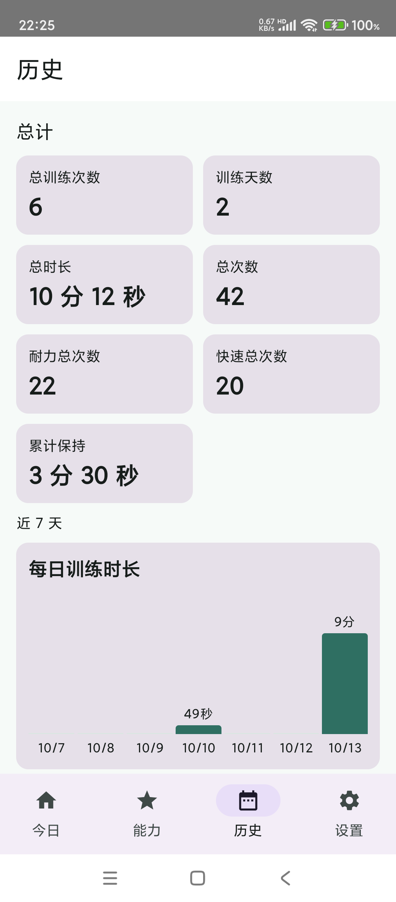
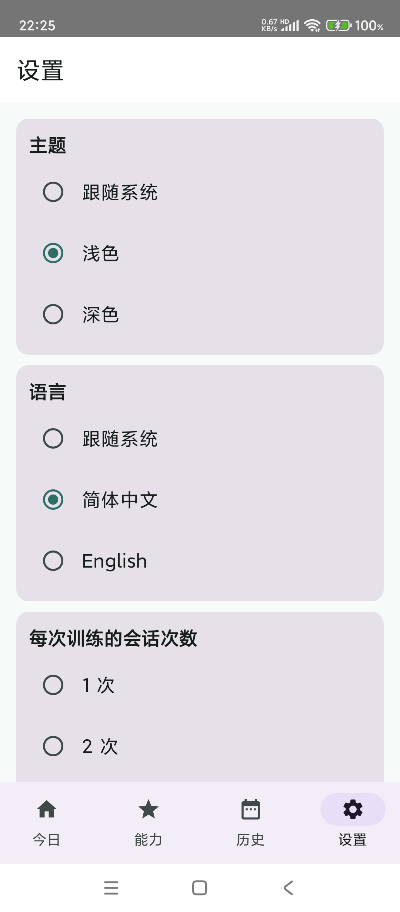

# Pelvic Trainer (盆底肌训练)

[简体中文](./README.md)

A voice-first **Kegel training app for men**: put on headphones and follow spoken cues — "tighten, hold, relax" — with no screen-staring and no mental counting. Train through levels L1–L6; every session is logged and charted automatically.

<p align="center">
  
  
  
  
</p>

## The problem it solves

The hard part of Kegel (pelvic floor) training is not the exercise — it's consistency. Typical apps make you watch a countdown and count reps in your head, which is fiddly and distracting. Here the audio carries the whole session: the voice says "tighten", "hold 3, 2, 1", "relax", and you just follow it — sitting or standing, on the commute or between meetings.

## Who it's for

- Men who want to start (or keep) Kegel training without being tied to the screen
- Anyone who prefers explicit level targets instead of guessing seconds and reps
- Privacy-minded users who want their data to stay on the phone

## Core features

- **One-tap daily training**: a script of "1 endurance group + 1 quick round" generated from your current level, fully voice-guided (Chinese / English audio)
- **Optional ability assessment**: 5 items (movement control, endurance hold, endurance reps, quick reps, relaxation quality), all with built-in timers, countdowns and audio cues — no manual counting; suggests a training level L1–L6
- **Six-level standards**: each level's "sessions/day × reps/session = daily reps" is listed on the Standards page (endurance, quick and daily-total tables), viewable anytime
- **Full control mid-session**: pause, resume, end early, safety exit (stop immediately on pain or fatigue); a low-key mode runs silent with subtitles and countdown only
- **Frequency and down-dose**: pick how many sessions per day (3 for low levels, 6 for L6) and a half-dose switch; ≤10 per endurance group, ≤20 per quick round, ≤40 per session
- **History and stats**: totals (sessions, days, total time, total reps, endurance/quick split) plus daily time and daily reps bar charts and a daily detail table
- **Progress tab**: endurance and quick stats kept separate; training days, session count and level history at a glance
- **Light / dark / system theme, zh-CN / English**: unsupported system languages fall back to Chinese; switching never loses an in-progress session

## Quick start (build from source)

Requires JDK 17 and an Android SDK (compileSdk 36 / minSdk 31); Gradle Wrapper is included.

```bash
export JAVA_HOME=/path/to/jdk-17
export ANDROID_HOME=/path/to/android-sdk
./gradlew assembleDebug          # -> app/build/outputs/apk/debug/app-debug.apk
./gradlew testDebugUnitTest      # 44 domain unit tests
adb install -r app/build/outputs/apk/debug/app-debug.apk
```

Audio cue assets can be regenerated offline on macOS: `bash tools/make_cues.sh`.

## Health boundary

- This is a **training aid and self-tracking tool**: no medical diagnosis, no promised therapeutic effects (including ED/PE); the in-app assessment is not a clinical strength test.
- If you experience pain, persistent abnormal tension, or notable urinary/bowel issues, use Safety Exit to stop and consult a doctor or pelvic-floor physiotherapist.
- All data stays in the app's private storage on your device. No network, no accounts.

## Project layout

| Path | Contents |
|---|---|
| `app/` | Android app (Kotlin 2.1.20 + Jetpack Compose + Media3; `com.orca.kegel`) |
| `docs/pm/` | Product plan and requirement source of truth (Product Plan V2.2) |
| `docs/design/` | Design contract: interaction spec, freeze notes, clickable prototype (`docs/design/prototype/`) |
| `docs/qa/` | Acceptance traceability matrix and per-item evidence (`docs/qa/evidence-P045/`) |
| `docs/roles/`, `docs/handoff/` | Development-process governance docs (ORCA role cards and handoff log) |

## Current version

`v1.1` (versionCode 2) · Android 12+ · Simplified Chinese / English.
