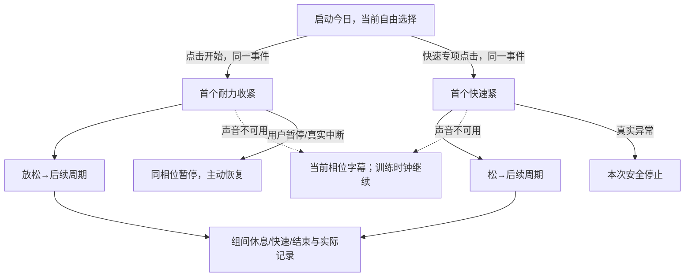

# UX-V1.4｜生成流程视图

唯一机器真源UX_CONTRACT.json；用户V4授权起练零前置/零等待，详情见prototype/PROTOTYPE_V4-变更说明.md。SPEC及原需求源保持。

没有准备、试听确认或语音初始化门槛；阶段计时不等语音回调。首周期同步计额度，不因重复点击/恢复再次扣。语音不可用不会阻训练；真实通话中断仍暂停。仅删除准备10秒，训练内休息/结束和日40规则保持。

## 正式流程

- **FL-01 可选首次摸底（随时跳过）**：INT-01, INT-02, INT-03, INT-04, INT-05, INT-06, INT-07, INT-08, INT-32, INT-64, INT-65
- **FL-02 等级结果与采用**：INT-09, INT-10, INT-11, INT-29, INT-40
- **FL-03 今日自动组合**：INT-01, INT-12, INT-16, INT-17, INT-18, INT-37, INT-38, INT-40, INT-32, INT-56, INT-60, INT-62, INT-63, INT-69, INT-70
- **FL-04 耐力专项**：INT-29, INT-13, INT-16, INT-18, INT-32, INT-60
- **FL-05 快速专项**：INT-29, INT-13, INT-17, INT-18, INT-32, INT-60
- **FL-06 语音阶段与离屏推进**：INT-16, INT-17, INT-18, INT-34, INT-39, INT-60
- **FL-07 暂停、中断与恢复**：INT-01, INT-19, INT-20, INT-21, INT-22, INT-24, INT-34, INT-35, INT-32, INT-55, INT-61
- **FL-08 结束、保存与历史统计**：INT-18, INT-22, INT-23, INT-24, INT-25, INT-26, INT-27, INT-28, INT-60, INT-61
- **FL-09 重新摸底与确认等级**：INT-29, INT-30, INT-31, INT-03, INT-04, INT-05, INT-06, INT-07, INT-08, INT-09, INT-10, INT-11, INT-40, INT-32, INT-64, INT-65
- **FL-10 安全停止与退出**：INT-03, INT-07, INT-26, INT-32, INT-33, INT-25, INT-41, INT-42, INT-44, INT-45, INT-55
- **FL-11 权限、音频失败与离线**：INT-20, INT-34, INT-36, INT-39, INT-37
- **FL-12 可选EHS启用、自报、跳过、历史、关闭与清除**：INT-46, INT-47, INT-48, INT-49, INT-50, INT-51, INT-52, INT-53, INT-54, INT-57, INT-58
- **FL-13 自由选级起练（有无等级均可）**：INT-01, INT-62, INT-63, INT-12, INT-69, INT-70, INT-71, INT-72
- **FL-14 各级标准可查看与独立等级选择**：INT-01, INT-29, INT-66, INT-67, INT-68, INT-69, INT-70

16屏/68交互/58状态。UX PASS不等于runtime或Human2批准。
