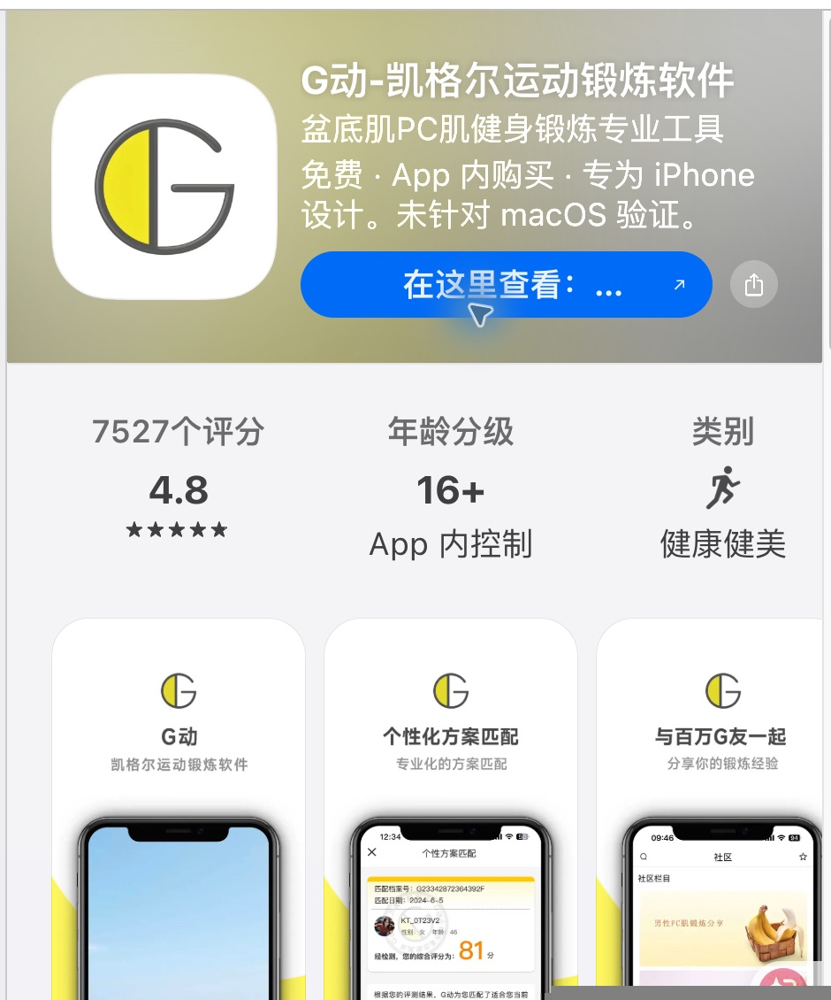

# Human 1｜选择整体设计方向

**TASK-010 · V1.6 · WAITING_HUMAN_DIRECTION_SELECTION**

先打开 [三方向比较入口](index.html)，再分别看 [A 随身语音教练](directions/A/index.html)、[B 能力工作台](directions/B/index.html)、[C 节律训练手册](directions/C/index.html)。每套有首次摸底、等级结果、今日训练、语音训练阶段、历史统计五个移动端关键界面；页顶可跳到对应界面。

**建议 A。** 日常目标是摸底后戴耳机完成自动组合训练，A 的今日入口、单一主动作和沉浸式阶段最贴合这个目标。B 适合优先理解负荷依据与数据对照；C 适合优先理解动作和训练顺序。

## 这次选择的边界

需求唯一来自 [用户 Product Plan V1.1](../../temp/用户草稿-Product Plan V1.1.md) 的 FR/AC；行为解释在 [SPEC](SPEC.md)。Product Plan 仍为用户草稿，TASK-010 授权本轮设计研究，不代表草稿中的开放项已经批准。

本轮只选整体方向。手机界面内的数值、文案、颜色和间距都是方向示意；不冻结分级阈值、每日频率、重新摸底周期、快速训练命名或中断行为。L2 的训练参数采用 Plan 草案示例；五维输入到 L2 的映射**没有算法验证**。所有统计为可识别的演示数据，不写入任何真实记录。预览是静态 HTML，框内控件不执行训练；只有页顶索引和材料链接可点击。本次提供 HTML，未生成方向 PNG。

## 真实参考与可看证据

采集日期：2026-10-07。`OBSERVED` 只指本轮在可回访来源看到的内容；商店宣传或开发者说明不等于安装后实测。`INFERRED` 是结合来源与本项目需求作出的设计判断。

| 来源 | 这次确实看到的内容 | 学习什么 | 避开什么 |
|---|---|---|---|
| [SRC-01 · G动 / App Store](https://apps.apple.com/cn/app/g%E5%8A%A8-%E5%87%AF%E6%A0%BC%E5%B0%94%E8%BF%90%E5%8A%A8%E9%94%BB%E7%82%BC%E8%BD%AF%E4%BB%B6/id1096015822) | 宣传截图有方案匹配、综合评分和推荐；开发者列出训练记录、声音与内容入口 | 把结果连到可执行方案 | 不复制综合分数、课程商城与社区 |
| [SRC-02 · Squeezy Men / Google Play](https://play.google.com/store/apps/details?id=com.propagator.squeezyformen)；[SRC-03 · 官方说明](https://squeezyapp.com/how-it-works/) | 截图有慢/快阶段、重复环、暂停和声音入口，进度分列两类；开发者列出音频提示和图表 | 阶段明确、分类记录，语音辅助可提升为本项目主通道 | 不让专业调参成为每日前置，不移植其医疗身份 |
| [SRC-04 · Kegel – Trainer for Men / App Store](https://apps.apple.com/ca/app/kegel-trainer-for-men/id6737899983) | 官方版本历史提及新增测试、振动与详细统计；描述扩展到呼吸和瑜伽 | 测试与训练历史构成闭环 | 不扩展成泛健身，不靠徽章自动晋级 |
| [SRC-05 · Elvie Trainer 官方支持](https://support.elvie.com/en-gb/app-support/elvie-trainer-app-support) | 官方说明有等级、训练历史与分类结果，实时反馈依赖硬件 | 分类结果与训练频率分开看 | 女性硬件产品的感测分数和晋级条件不能移植 |

### 参考图

以下是桌面 Chrome 查看真实商店页面后保存的**局部截图**，含宣传手机界面。裁切不完整，原始来源可回访；它们不是安装后操作录像，也不是本项目设计图。

[打开 G动参考图](research/assets/SRC-01-G动-AppStore.png)



[打开 Squeezy Men 参考图](research/assets/SRC-02-Squeezy-Men-GooglePlay.png)


### 动作与能力语义的补充来源

[Oxford NHS 男性盆底指南](https://www.ouh.nhs.uk/media/in3ekdyl/74150guide.pdf)、[Sussex NHS 男性盆底练习指导](https://www.uhsussex.nhs.uk/resources/male-pelvic-floor-exercises/) 和 [NIDDK 指导](https://www.niddk.nih.gov/health-information/urologic-diseases/kegel-exercises)均强调正确目标肌群、收缩后放松，前两者分别说明慢/快练习。**推断**：在本项目中，放松应为有提示的明确阶段，摸底不能只看保持秒数；这同时受 AC-004、010、012 约束。不同指导的频率和间隔存在差异，本轮不据此定训练处方，更不新增疗效承诺。

## 从证据到方向

完整的来源、观察、模式与限制在 [RESEARCH_PACKAGE.json](RESEARCH_PACKAGE.json)。以下是**设计推断**，不是对竞品内部算法的观察。

| 模式 | 支撑来源 | 本项目用法 |
|---|---|---|
| PAT-01 · 摸底连接负荷建议 | G动、Kegel Trainer、Oxford NHS | 五维自报与短板限制，不新增评分体系 |
| PAT-02 · 两类训练与完全放松分开表达 | Squeezy Men、Oxford/Sussex NHS | 今日自动串联，阶段仍清楚 |
| PAT-03 · 超越屏幕计时的提示 | G动、Squeezy Men、Kegel Trainer | 耳机语音主导；离屏目标来自 FR-006，尚未实测 |
| PAT-04 · 分类历史 | Squeezy Men、Kegel Trainer、Elvie | 耐力/快速分别统计，另列天数、次数与等级 |
| PAT-05 · 结果直接连今日方案 | G动、Squeezy | 参数自动生成，减少每日选择 |
| PAT-06 · 质量优先、能力与记录分开 | Elvie、Oxford NHS、NIDDK | 非医学等级，不按打卡自动升级 |

## A｜随身语音教练 · 推荐

**核心逻辑：今日任务为中心，完成比阅读优先。** 三个底部入口为今日、能力、记录。首次摸底逐项推进；建议结果后直接采用今日方案。训练中收起底部导航，保留阶段、剩余量、暂停和提前结束。

**视觉：** 低密度卡片、较大留白、自然绿色；语音阶段用深色沉浸页和呼吸圆强调“完全放松”。历史使用分类摘要和轻量日历，不展示综合能力分数。

[查看 A 的五屏预览](directions/A/index.html)

| 首次摸底 | 等级结果 | 今日训练 | 语音阶段 | 历史 |
|---|---|---|---|---|
| 单步动作/放松确认，随后三项数量 | 建议等级＋五维输入＋六项负荷 | 单一开始入口，两段自动组合 | 大阶段＋圆形秒数＋语音提示 | 分类量＋日历＋等级变化 |

来源模式：PAT-01～06；不是 G动推荐页或 Squeezy 圆环的整套复制，组合的是“结果到任务”“分类”“质量”“声音”模式。

**优点：** 日常路径短；阶段层级适合低注意力场景；开始训练不要求调参。

**代价：** 首屏容不下完整跨期对照；首次摸底需要逐步推进，数据解释须次级页补充。

## B｜能力工作台

**核心逻辑：能力档案为中心，输入、负荷、训练、趋势可对照。** 四个入口为能力、训练、趋势、设置。首次用质量检查和工作表收集输入；等级结果列出输入与参数矩阵；训练以阶段队列执行。

**视觉：** 中高密度网格、方角表格、蓝色重点。播放器展示阶段序列、当前放松计时与剩余次数。历史把训练量小图与分类表放在同屏，明确它们不是肌力曲线。

[查看 B 的五屏预览](directions/B/index.html)

| 首次摸底 | 等级结果 | 今日训练 | 语音阶段 | 历史 |
|---|---|---|---|---|
| 质量检查＋数值工作表 | 五维输入与负荷矩阵 | 自动处方队列，专项为次级切换 | 阶段序列＋计数表＋语音 | 训练量趋势＋分类明细＋摸底对照 |

来源模式：PAT-01～06；参数可复核的设计由本项目 AC-006 与分类记录共同决定，不照抄竞品专业模式。

**优点：** 推荐依据与训练参数可解释；耐力/快速明细容易比较；历史复盘效率高。

**代价：** 初次阅读负担较高；数字多可能诱发盯屏，语音必须独立；后续需验证数据能否被正确理解为训练记录。

## C｜节律训练手册

**核心逻辑：一次练习是一条连续主线，先理解质量再执行。** 无常驻底栏，通过手册目录、章节返回和日志互链。首次以动作、耐力、快速三个教学章节进入五维摸底；今日页呈现从准备到完成的训练行程。

**视觉：** 纸张底色、衬线标题、抽象地形与章节编号；训练阶段用横向节奏带明确当前“放松/休息”。历史是逐日日志和周合计，等级是有限六阶负荷示意。

[查看 C 的五屏预览](directions/C/index.html)

| 首次摸底 | 等级结果 | 今日训练 | 语音阶段 | 历史 |
|---|---|---|---|---|
| 先教学，再逐章完成五维 | 六阶起点＋输入叙述＋负荷 | 纵向训练行程 | 横向节奏带＋放松语句 | 逐日分类日志＋周合计 |

来源模式：PAT-01、02、03、04、06；章节/地形为本项目设计表达，没有外部观察证明其易用性更好。

**优点：** 对首次动作与放松更有解释空间；顺序连贯；语气温和，减少竞赛感。

**代价：** 路径较 A 长；跨周数据比较不及 B；要避免每日重复教学，以及阶梯被理解成自动晋级。

## 三方向的实质差异

| 设计轴 | A | B | C |
|---|---|---|---|
| IA / 首页重心 | 今日任务 | 能力档案 | 今日练习手册 |
| 层级 | 开始与当前阶段 | 输入、参数及对照 | 动作理解与放松 |
| 页面结构 | 单步与摘要卡片 | 工作表、矩阵、队列 | 章节、行程、日志 |
| 导航 | 三栏，训练时隐藏 | 四栏＋模块分段 | 章节互链，无常驻底栏 |
| 密度 | 低 | 中高 | 逐步揭示 |
| 交互模型 | 一键语音执行 | 确认处方后执行队列 | 教学章节接训练行程 |
| 意象 | 呼吸圆 | 网格与数据线 | 纸张与抽象地形 |
| 数据表达 | 分类摘要与日历 | 明细表与趋势 | 六阶示意与逐日日志 |

每对至少 2 轴：A–B 在 IA、层级、结构、导航、密度、交互、数据上不同；A–C 在 IA、结构、导航、交互、意象、数据上不同；B–C 在全部八轴不同。三者的产品能力与语音要求相同，区别是组织和表达；颜色只是一项示意。

## 技术复用口径

遵守 [TECH-REUSE-POLICY](TECH-REUSE-POLICY.md)，方向选择不锁技术栈。

| 对象 | 类型 | 本轮说明 |
|---|---|---|
| 静态预览 | REUSE | 原生 HTML/CSS，离线即可查看，无新增依赖 |
| 后台播放与耳机控制 | REUSE（候选） | 优先审查官方 [Media3 后台播放](https://developer.android.com/media/media3/session/background-playback) 和 [MediaSession 控制](https://developer.android.com/media/media3/session/control-playback)，文档能力不等于项目已实测 |
| 训练阶段与提示映射 | ADAPT（候选） | 在官方媒体能力上配置业务语义，避免自建底层引擎 |
| 自己的旧代码/技术样机 | REVIEW_FOR_REUSE | 未审计，不能直接搬用；技术样机只属 TEMP_FEASIBILITY_EVIDENCE |
| 自建实现 | BUILD（未选择） | 当前无证据证明官方/成熟实现不适用，不因设计方向启动自建 |

正式 Reuse Audit 位于 Prototype Approval 之后、SDD 之前，届时补版本、License、维护与质量证据。A/B/C 均不因视觉不同换音频技术。

## Gate 与限制

- `DESIGN_RESEARCH=PASS`：仅针对 Human 1 所需的公开来源、模式及方向比较。已取得真实可回访产品和局部 UI 证据；来源不足时才应阻塞，不能用常识冒充观察。
- 未取得竞品完整测试流程、私有阈值或耳机/锁屏运行实测；本轮不对这些能力判 PASS。医学指导只帮助解释训练语义，不替代产品参数决策。
- `selected_direction=null`，状态为 `WAITING_HUMAN_DIRECTION_SELECTION`。尚未选中方向，也未进入正式 UX、产品模拟器或 Design Freeze。

## 请你选择

直接回复 **A / B / C**，也可以先指出要调整的方向。建议 A：最贴合“戴耳机完成今日自动组合”的主任务。选择 B 会优先建设能力档案与数据对照；选择 C 会优先建设动作教学与章节式训练路径。

选择之后才进入该方向的正式 UX Contract，解决中断恢复、状态与错误路径；本轮在 Human 1 等待，不自动跨过人工选择。

**交回 Task Manager 的 HANDOFF 行（本轮未修改 HANDOFF）：**

```text
Design｜TASK-010｜DESIGN_RESEARCH=PASS｜SPEC=docs/design/SPEC.md｜RESEARCH=docs/design/RESEARCH_PACKAGE.json｜DIRECTION_SET=docs/design/DIRECTION_SET.json｜HUMAN1=docs/design/HUMAN1-方向选择.md｜selected_direction=null｜WAITING_HUMAN_DIRECTION_SELECTION
```
